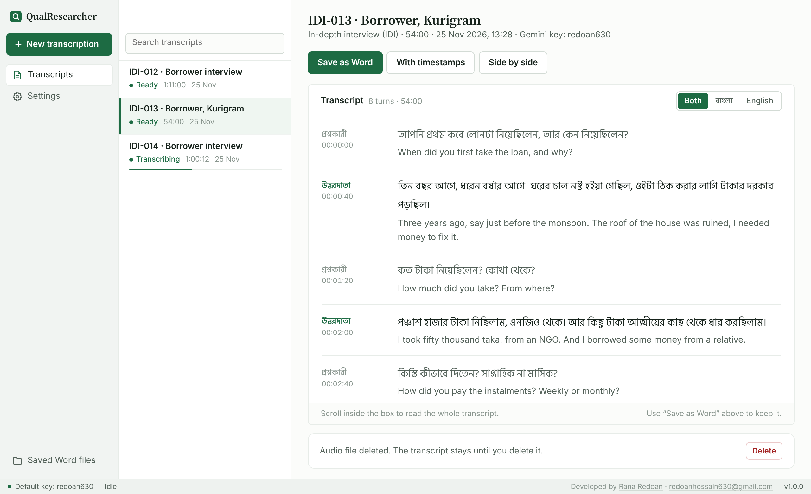

# QualResearcher

A Windows app that turns Bangla interview recordings (IDI, KII, FGD) into verbatim Bangla transcripts, with an English translation when you want one, and saves them as Word files. It runs on your own computer and uses your own Google Gemini API key.

## Download

**[Download the latest installer](https://github.com/RanaRedoan/QualResearcher/releases/latest)**: open the page and click `QualResearcher-Setup-….exe` under *Assets*.

- [How to install and use it](docs/INSTALL.md) (বাংলায়)
- [How to get a Gemini API key](docs/GEMINI_API_KEY.md) (বাংলায়)

## What it does

- Verbatim Bangla, including dialect, fillers and repetitions, with cues such as [হাসি] and [দীর্ঘ নীরবতা].
- Speakers labelled: interviewer and respondent, or moderator and participants.
- English translation now or later, shown side by side.
- The transcript appears live while it is written. A long recording that stops halfway can be continued from where it stopped.
- Word files: clean, with timestamps, or Bangla and English side by side. Every file starts with a reminder that the transcript was made with AI help and must be checked.
- Several named Gemini keys, and you choose which one each recording uses.

## Privacy

Recordings and transcripts stay on your computer, in `%LOCALAPPDATA%\QualResearcher`. Audio leaves it only while it is sent to Google Gemini for transcription, and it is deleted from the computer after the number of days you choose. Use a Gemini key whose project has billing set up for real participant data: on the free tier Google may use what you send to improve its products.

## For developers

Run from source, build the installer and publish a release: see [docs/DEVELOPING.md](docs/DEVELOPING.md).

---

Developed by [Rana Redoan](https://github.com/RanaRedoan) · redoanhossain630@gmail.com
